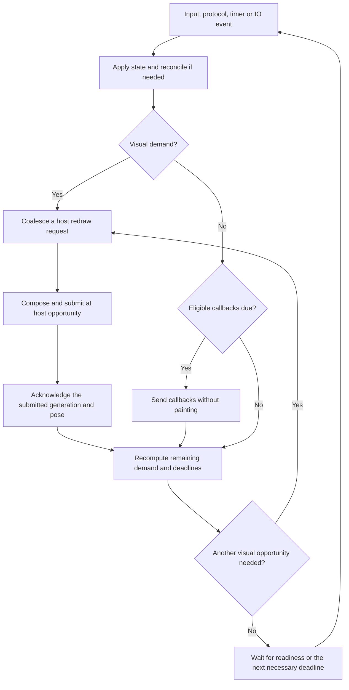

# Demand-driven rendering — implementation plan

**Status: demand-driven scheduling and conservative incremental damage implemented.**
The original proposal below was reviewed against `dc2bcfc`. The first five stages
now stop quiet rendering, pace callbacks independently and use explicit IO and
maintenance wakeups. Stage six uses actual buffer age for ordinary unfiltered
client updates, with bounded destination identities and conservative complete
redraws for motion, policy/recovery and filtered scenes. Partial compositor-motion
rendering and filter dependency reuse remain future work. See the validation
record in [testing](vm-testing.md#demand-driven-rendering-2026-10-11).
Implemented contracts live in [platform timing](../specs/platform.md#nested-frame-timing),
[animations](../specs/animations.md), [overview](../specs/overview.md),
[rendering](../specs/rendering.md), and [shell IPC](../specs/shell.md).

The original goal was to stop submitting identical frames when the desktop is quiet, while
keeping client updates, compositor animations and pointer interactions responsive.
Implement idle scheduling first with complete-frame rendering on demand. Add
incremental damage separately, after wakeups and lifecycle tests pass. Idle
scheduling does not require partial rendering to deliver its main benefit.

## 1. Original behavior and proposed changes

| Code at the original review | Consequence | Proposed change |
| --- | --- | --- |
| Previous [backend.rs](../src/platform/smithay/backend.rs) requested another redraw after every successful submit | A static scene continued drawing at host cadence | Request another opportunity only for pending rendering or callback work |
| [FrameScheduler](../src/platform/smithay/frame_scheduler.rs) coalesces requests and selects animation samples | It has no dirty-scene or idle decision | Add a small demand state and deadline calculation around the existing sampling law |
| [Compositor::reconcile](../src/platform/smithay/scene.rs) consumes `dirty` | Layout can be clean while pixels still need updating | Separate policy dirtiness from outstanding visual invalidation |
| [frame_callbacks](../src/platform/smithay/scene.rs) runs after submission | A client waiting to animate depends on that render loop | Detect committed callback requests and service them on explicit paced opportunities |
| [mod.rs](../src/platform/smithay/mod.rs) uses a 16 ms maximum loop timeout | Shell polling, cleanup and shutdown benefit from periodic turns | Replace each dependency with readiness or a specific maintenance deadline before removing the timeout |
| [shell::Server](../src/shell/server.rs) polls nonblocking sockets | Idle shell commands and queued replies have no independent event source | Integrate listener/client readiness, buffered continuations and pending writes |
| Captures are checked inside redraw | An idle scene would miss its capture deadline | Arm a capture timer that requests a complete frame |
| [FPS](../src/platform/smithay/fps.rs) updates only on submissions | The last high reading would remain visible while idle | Add a bounded idle indication without making the HUD a perpetual render source |

The source review's [damage and redraw findings](animation-performance-review.md#damage-tracking-and-callback-driven-redraws)
were the starting point. Submission and event-loop counters verify idle behavior;
no physical input latency, idle-power improvement or active-frame percentage
speedup is claimed.

## 2. Separate policy, rendering and callback demand

Keep scheduling in `src/platform/smithay/`. Core desktop policy should not know
about host redraws, EGL, surface callbacks or Calloop registrations. Preserve the
backend-independent animation engine and shell transport boundaries.

Add a concrete `RenderDemand` structure, preferably alongside the adapter's frame
scheduler, with:

- Visual invalidation and submitted generation counters. Increment visual demand
  for anything that can change compositor pixels. Reconciliation must not clear it.
- A fixed reason bitset for diagnostics: surface, layout/appearance, interaction,
  animation/terminal, host exposure/resize, capture and HUD. Coalesce reasons;
  do not retain an event log per frame.
- A coalesced host-request flag, plus a forced-frame flag for exposure, capture,
  invalid buffer history and terminal animation submission.
- The earliest pending render/callback deadline and bounded timer-registration
  bookkeeping. Derive animation and callback work from their actual owners.

Keep `Compositor::dirty` for policy reconciliation initially. Introduce named
helpers such as `invalidate_scene(reason)` and `invalidate_policy(reason)`;
the latter also invalidates rendering when its result may change appearance.
Audit direct assignments rather than assuming every `dirty = true` is an
adequate wakeup. Callback-only demand should not rerun layouts or Rhai.

The scheduling flow is:

On a render, capture the invalidation generation being serviced. Mark only that
generation submitted after success. If acknowledgement, deferred reconciliation
or another event creates newer demand, leave it pending. Never clear all demand
unconditionally at the end of a frame.

### Connect demand to the backend

The graphics backend and renderer caches currently live in the Winit event
closure. Protocol and shell handlers cannot directly ask that closure to draw.
Add a Calloop ping source: handlers update demand and ping it; the source
coalesces work and calls the host's `request_redraw` when appropriate.

A concrete adapter-only ownership option is to share the nested graphics backend
between the Winit and ping closures through `Rc<RefCell<_>>`, retaining renderer
caches in the render closure. Borrow only while handling an individual event;
pinging during rendering queues later work and must not synchronously borrow the
backend again. An equivalent small `NestedRenderer` owner in adapter state is
acceptable if it makes borrowing clearer. Avoid a general backend framework.

The pinned backend returns `&dyn Window` from `window()`; do not assume that
reference is a cloneable owned host handle. Keep the pinned dependency unchanged
for this first step.

## 3. Cover every wakeup source before disabling continuous redraw

| Source | Hooks to audit | Work to queue |
| --- | --- | --- |
| Effective application content commit | [protocols.rs](../src/platform/smithay/protocols.rs), renderer surface-state update | Refresh committed appearance and render affected visible trees |
| Subsurface content, position, ordering, scale, transform or viewport | Parent/child commit application and synchronized-tree traversal | Invalidate the owning window/layer/popup after state becomes effective |
| Map, null-buffer unmap, destruction or disconnect | Protocol lifecycle, client disconnect and Space refresh | Reconcile policy, remove old pixels, retain closing images when applicable |
| XDG geometry, committed fullscreen/decoration state | Root commit and [decorations.rs](../src/platform/smithay/decorations.rs) | Refresh the correct committed outline/inset; an ACK alone does not switch appearance |
| Title, app ID, focus or SSD controls | Metadata, focus, titlebar interaction | Update titlebar/style and any changed placement |
| Popup map, reposition, dismissal or destruction | XDG popup handlers, PopupManager cleanup, layer popups | Draw new bounds and erase old bounds, including cleanup with no subsequent parent commit |
| Layer map/unmap, geometry or reservation | [layers.rs](../src/platform/smithay/layers.rs) | Reconcile usable areas, stacking and keyboard ownership, then render |
| Desktop commands and successful reload | [state.rs](../src/platform/smithay/state.rs), runtime actions and shell mutations | Reconcile once, invalidate appearance, retarget or settle animations |
| Overview authorization/selection and drag | Input, grab release, layer focus changes, [overview_animation.rs](../src/platform/smithay/overview_animation.rs), [overview_drag.rs](../src/platform/smithay/overview_drag.rs) | Service queued entry, selection changes, direct pointer movement and animated scale/offset |
| Host resize, redraw/exposure or focus change | Winit events already exposed by the pin | Resize/reset history or request recovery; preserve existing focus-loss cleanup |
| Eligible committed frame callbacks | Surface-tree callback inspection | Pace callback delivery; request pixels only when visual demand exists |
| Shell listener/read/write readiness | Adapter socket registrations and server progress | Dispatch bounded commands, flush replies/publications; read-only requests do not draw |
| Capture and bounded shutdown | Explicit one-shot timers | Force a capture frame or stop the loop, independently of normal redraws |
| Child exit and advisory-target expiry | Maintenance deadline or supported process readiness | Reap/prune without rendering unchanged pixels |

Initially, render conservatively for effective commits affecting a potentially
visible tree. Tighten content classification later to recognize callback-only or
input-region-only commits without guessing from a damage rectangle alone. New
buffer assignments, committed geometry and compositor decoration changes can
matter even when reported damage is empty.

Use committed state, not pending requests. Synchronized subsurface commits can
cache updates until a parent applies them; desynchronized children can update
independently. Walk the effective tree after application and preserve its root
ownership. Track hidden changes so showing a workspace/card later uses fresh
content, but do not repeatedly draw a hidden surface with no visible contribution.

For input, distinguish protocol forwarding from compositor presentation. A
pointer moving over an unchanged ordinary client need not repaint Clear's scene.
A window drag, overview ghost movement or changed selection does. Full cursor
surfaces are currently unsupported; future cursor rendering will need its own
invalidation rather than being implicitly covered by continuous drawing.

Pending overview entry should be retried when its authorization conditions
change: focus, grabs, held/intercepted releases, layer ownership or client teardown.
A pending request alone must not keep an otherwise quiet scene rendering.

## 4. Preserve animation timing and the final submitted frame

Expose adapter-level demand queries for normal-window/workspace motion, overview
entry/exit/tile zoom and drag pickup/scale. Reuse
[`PresentationPlanner::is_animating`](../src/runtime/presentation.rs), which
includes an unacknowledged terminal pose. Add equivalent submitted-revision-aware
queries to overview and drag state. Presence of an overview session, drag object,
GPU snapshot or engine track is insufficient: these can remain after motion stops.

Do not reuse the last redraw timestamp to start a transition after a long idle.
Today reconciliation can reach animation synchronization before the next redraw,
and those paths use `frame_time`. Capture current monotonic time for policy-triggered
animation changes explicitly. Otherwise an animation started after idle may appear
already finished on its first frame. Retarget from the last submitted pose/phase
with the engine's existing interruption rules; never replace displayed hit geometry
with a prediction merely to update the clock.

For the first scheduling release, retain host opportunities while any animation
needs rendering. Keep the existing refresh-rate default, absolute 30/60/120 sample
selection, missed-deadline skipping, interval-1 swaps and no divisor fallback.
Client and pointer work may require opportunities between capped pose samples.
Optimizing those intermediate submissions is a later step, not a prerequisite
for stopping when all motion ends.

After each successful submit, acknowledge normal, overview and drag presentation,
then recompute demand. Closing overview acknowledgement can set policy dirty to
restore ordinary ownership; that handoff may need an additional ordinary frame.
Reduced motion, disable/reload settlement and zero-opacity final poses still need
the required terminal submission. Callback-only ticks never acknowledge a pose,
release a retained image or restore client input.

A finished transform waiting for an actual client size/fullscreen/SSD commit can
hold its displayed image without generating frames forever. Its eventual effective
commit is the wakeup. Failed rendering/submission keeps pending demand and follows
the current fatal-error path; a future retry policy must be bounded.

## 5. Pace client callbacks without painting identical pixels

Refactor `frame_callbacks` to accept an explicit monotonic callback timestamp.
Keep it independent from the last submitted render timestamp and capped animation
timestamp. Preserve wrapping millisecond timestamps through Smithay's helpers.

Inspect committed `SurfaceAttributes.frame_callbacks` using the pinned surface-tree
APIs. Do not drain callbacks to discover demand, count pending/unapplied callbacks,
or treat a cached rendering element as evidence that callbacks are pending.
Use shared eligibility/tree traversal for demand discovery and actual delivery:
ordinary windows plus their popups, layer trees plus their popups, and the bounded
overview live set. Deduplicate as the existing implementation does. Preserve current
ordinary/layer callback eligibility and overview-only 33 ms throttling initially;
pixel-level occlusion tightening would be a separate behavior change.

For a static frame with eligible callbacks pending, deliver them at an explicit
callback deadline without rebuilding thumbnails, blur or the host framebuffer.
An animating client then commits new content, which queues a render. A client can
request callbacks repeatedly while drawing nothing: continue to service that
protocol demand at its allowed cadence without submitting identical pixels.
When neither callbacks nor other work remain, disarm the deadline. When visual
work is pending, deliver callbacks through the successful render path and suppress
its duplicate callback timer. A pending host request must not repeatedly rearm an
already overdue deadline while waiting for the host; retain demand and await host
readiness/events without spinning.

The pinned backend calls `pre_present_notify` inside `submit`; it does not expose
a presentation-ready signal for callback-only work. Therefore a callback-only
`request_redraw` loop cannot be assumed to be host-paced. Use an absolute monotonic
timer based on the advertised host refresh for these deliveries, with the existing
overview throttle and skipped missed deadlines. It is an estimated opportunity,
not physical presentation feedback. Never dispatch a second callback immediately
just because a client recommitted during the same loop turn.

Classify callback-only commits using effective visual revisions: unchanged buffer
content/damage, geometry, mappings, stacking and compositor appearance. Unknown
changes should conservatively render. Existing renderer/import handling still
runs as required; callback-only service must not bypass commit processing or
buffer ownership. Verify this classifier with real no-damage callback clients.

Allow one already-queued host redraw to arrive after demand has drained. Complete
its bookkeeping without automatically queueing another. A genuine host exposure
still forces restoration; do not globally discard unsolicited redraw events.

## 6. Remove dependencies on the 16 ms maintenance loop

Stopping GPU draws can ship while retaining the current maximum timeout as an
explicit intermediate milestone. Complete event-driven idle additionally requires:

1. **Shell readiness.** Let the plain Unix server expose readiness needs/progress
   without importing Calloop. The adapter registers the listener and live streams,
   removes disconnected registrations and handles opaque connection identities.
   Register writable interest only while output is queued, removing it when drained.
   Preserve existing per-peer/global budgets and fairness. Already-buffered complete
   requests or budget-exhausted actionable work need a coalesced next-turn
   continuation even when the socket has no new readable bytes. EAGAIN requires
   readiness, not an immediate retry loop. Replies/publications queued after polling
   must schedule their write work; read-only IPC and icon hints need no repaint.
2. **Wayland output flushing.** Continue flushing clients after callbacks, input,
   configures and shell-driven changes. Verify the pinned display integration's
   handling of blocked writes before indefinite sleep. Use supported write readiness,
   or a temporary bounded retry deadline only while writes are blocked; no busy loop.
3. **Capture and exit.** Convert capture and `--exit-after` checks to independent
   timers. Capture forces a complete current frame and preserves EGL target
   restoration. A nondrawable host retains capture demand without spinning; exit
   remains bounded even when no frame opportunity arrives. Do not promise capture
   through suspension the current backend cannot observe or render through.
4. **Housekeeping.** Run popup cleanup and Space/output membership refresh after
   relevant lifecycle changes, with visual invalidation if cleanup changes a scene.
   Reap spawned children through process readiness where practical, or a modest
   timer only while children exist. Schedule the nearest advisory-target expiry;
   expiry itself does not change an already captured minimize trajectory or draw.
5. **Loop sleeping.** Replace the blanket timeout with registered sources and
   necessary deadlines; use indefinite waiting when there are none. Deadline
   registration changes must wake the loop. An idle event-loop turn must not
   invalidate the scene merely because it performed maintenance.

Use a shared earliest deadline for frame/callback work rather than one periodic
timer per surface or animation. Maintain at most one pending host draw request;
remove/rearm timer tokens on demand changes and teardown. Derive live surface sets
from existing ownership instead of accumulating another unbounded callback queue.

The pin does not forward host occlusion/monitor-move notifications. Check available
monitor metadata whenever handling a host opportunity, and keep the existing
nominal fallback. Explicit suspension/visibility handling needs a separate adapter
capability change. Host focus loss is not proof that the host is occluded.

## 7. Prevent the FPS overlay from defeating idle

Keep counting actual successful submissions, including diagnostic frames. Do not
count callback ticks, requested opportunities or maintenance turns as rendered FPS.
The present measurement naturally includes time without submissions; it is not
an animation-only throughput benchmark.

Recommended UI behavior is to show `Idle` once rendering has been quiet for a
short interval, rather than leave a stale 144 FPS reading. Implement that with
one timer per idle episode, anchored to the last nondiagnostic visual work.
Its single HUD invalidation must not reset that anchor or arm itself again.
An incoming real change cancels idle status and resumes normal measurements.
Retain the small texture cache; do not upload text on every callback tick.

With the overlay disabled, a quiet scene should have no diagnostic timer. With it
enabled, the one idle-indicator update is an explicit exception to zero submissions
after settlement. Document and test this exception in the rendering spec when
implemented. An average interval spanning idle time may be large without indicating
an expensive active frame; use separate phase timings for active-frame performance.

## 8. Add incremental damage after idle scheduling works

This is a second deliverable. Keep complete-frame drawing and age zero for the
first demand-driven release; unchanged frames are already eliminated.

For incremental rendering:

- Give generated wallpaper, titlebar, window-image, outline, overview and HUD
  elements stable identities. Change commit/content versions only on appearance
  changes; preserve old and new bounds for transforms, opacity, clips and stacking.
  Merely reusing an ID with an unchanged commit for a replaced texture is incorrect.
- Query the pinned backend's actual buffer age only for the correctly bound current
  window surface, after resize/current-target handling. Age lookup and renderer
  borrowing need a deliberate adapter helper or short binding scopes; do not
  assume `bind`, an offscreen pass or a stale EGL target makes the query valid.
  Unknown/zero age and invalid history force a complete redraw.
- Feed valid history into `OutputDamageTracker`, then submit the damage returned
  by that render. Distinguish scene-change bounds from buffer repair damage; retain
  the single-framebuffer transform used by the pinned swap-damage implementation.
- Reset history on size/topology changes, exposure requiring recovery, renderer
  recreation, relevant reloads and failure. Capture must read a complete valid
  framebuffer; conservative full redraw is acceptable for it.
- Keep blur/glass frames conservative at first. Lower-scene changes can affect
  upper translucent trees beyond the direct damage. Gaussian support, Kawase
  pyramid sampling and glass displacement/magnification require dependency-aware
  expansion. Until that is implemented, rebuild the affected backdrop composition
  and mark its final texture fully damaged. A small changed foreground rectangle
  is not sufficient evidence to reuse filtered pixels.

When damage tracking skips a GPU draw, service due callbacks independently.
Do not call terminal animation acknowledgement on that path unless its exact
current revision/pose was already submitted; initially force submission whenever
terminal acknowledgement is outstanding. Preserve snapshot ownership and cache
limits throughout.

## 9. Suggested commit sequence and acceptance gates

| Commit | Scope | Gate before enabling the next step |
| --- | --- | --- |
| 1. Demand model and diagnostics | Generation/reason bookkeeping, coalesced ping, demand queries; continuous rendering remains enabled | Unit tests prove coalescing, generation preservation and bounded timers; no behavior change |
| 2. Complete invalidation coverage | Protocol/input/lifecycle/reload/exposure hooks, current-time transition startup, terminal/handoff queries | Synthetic and real-client cases prove every change creates demand |
| 3. Explicit maintenance wakeups | Shell readiness/continuations, callback discovery, capture/exit, blocked flush and housekeeping timers | Commands, replies and deadlines work with no periodic render; transport fairness preserved |
| 4. Idle rendering and callback-only service | Remove unconditional redraw; preserve full-frame rendering on visual demand; HUD idle policy | Quiet clients stop submissions, callback clients keep advancing, all motion completes and stops |
| 5. Idle event-loop sleeping | Remove blanket 16 ms timeout after its dependencies are migrated | Empty/quiet cases stop unnecessary loop wakeups; pending IO and shutdown remain reliable |
| 6. Incremental damage | Stable element versions, valid age/history, conservative backdrop handling | Pixel oracles catch stale bounds, trails, holes and invalid backbuffer reuse |
| 7. Filter dependency optimization | Blur/glass damage expansion and composition reuse, if profiling justifies it | Existing independent filter oracles and animated lower-scene cases pass |

Each behavior-changing commit updates the relevant specification in the same
change: platform owns scheduling/timing/capture, rendering owns HUD/damage, overview
owns preview callbacks and handoff, animations owns terminal retirement, and shell
owns readiness/transport semantics. Update adapter/shell module guidance when
ownership or workflows change. Keep proposals here until implemented; do not
declare demand-driven scheduling in current specs in advance.

### Verification to add during implementation

Pure scheduler tests should cover no demand/no request; many invalidations/one
request; invalidation surviving reconciliation or acknowledgement; a required
terminal frame; deadline rearming/cancellation; stale callback/timer generations;
late frames without catch-up bursts or reduced targets; and host/config refresh
changes. Keep existing 144 Hz non-divisor sampling tests. Test starting and
retargeting animations after seconds of idle, steady overview/drag objects with
finished tracks, held client commits and post-overview ordinary-scene handoff.

Add bounded real-client fixtures for:

- An empty compositor and a static mapped client with no requested callbacks.
  After initial settlement, no further submissions should occur with HUD off.
- A callback-only client that recommits no visual changes. Callback delivery
  continues at its permitted cadence while pixel submissions stop.
- A callback-driven animated client: content advances, a timer-created cursor
  blink wakes a previously idle scene, and stopping requests returns it to idle.
- Synchronized/desynchronized subsurface-only updates, popup deletion without
  a parent commit, layer reservation/unmap and client disconnect while idle.
- Hidden/minimized clients becoming visible; live overview cards/miniatures and
  their throttling; each of the eight compositor effects and interrupted motion.
- IPC during idle, replies/publications after read activity stops, writable
  backpressure, buffered request continuations and competing busy peers.
- Capture and exit with no clients, with a static scene, and without host redraws.
  A missing drawable host opportunity must not defeat the exit deadline.
- The HUD's single idle update, enable/disable reload and recovery on real work.

Expose bounded scheduler counters or a test/debug summary: render requests,
redraw events, successful submissions, callback-only deliveries, wake reasons and
time in preparation/filtering/submission. Use these to assert idle behavior;
the visible FPS number and a static screenshot cannot prove that draws stopped.
Avoid serializing a log line or shell publication for every frame.

After Rust changes, run the root fmt/check/test workflow and editor diagnostics,
then relevant bounded protocol/GPU smokes from [the testing guide](vm-testing.md).
Rebuild before fixtures. Compare release builds with identical clients, resolution,
refresh, theme and caps, using separate Cargo target directories for baseline and
candidate. Measure idle CPU and submission counts separately from active frame
times and first-frame latency after idle. CPU/GPU captures do not establish
physical pointer latency or actual monitor presentation; verify those manually
with the real nested example and, eventually, the native backend.

The first completion gate is a quiet desktop that stops painting, an animated
client that never stalls, and an input/policy change that wakes rendering without
an extra periodic wait. Partial damage and filter reuse are later improvements,
with their own correctness gates.
